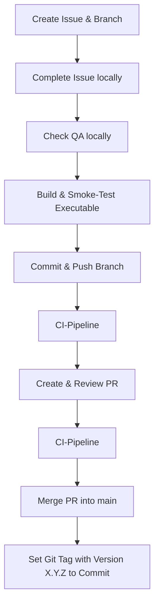

# Release Management
This document defines the Standard Operating Procedure (SOP) for cutting and releasing new versions of Savoria.

Note: Every release version has to be tagged with a git version tag (X.Y.Z), but not every versioned commit has to be a release version!

## Release Workflow

### Step-By-Step Guide:
- A Create issue and corresponding branch in GitHub repository
- B Complete issue locally: Note, for a release version, the version has to be set in [Pyproject](../../pyproject.toml) and the [Release Notes](./release-notes.md) have to be updated with an entry for version X.Y.Z.
- C Check QA locally: minmally run `uv run poe qa`, if necessary, also run manual smoke test.
- D Build executable `Savoria.exe` via  `uv run poe build-exe` and run a quick smoke test (not necessarily the full manual smoke test defined in testing.md) with it.
- E If necessary, first just commit parts, for last commit, use `uv run git-ship`.
- F When creating Pull Request, CI-Pipeline runs automatically.
- G Create and review Pull Request.
- H When merging Pull Request into branch `main`, CI-Pipeline runs automatically.
- I Merge Pull Request into branch `main`.
- J Set git tag with the matching version X.Y.Z.

## Versioning
The following versioning system is used: X.Y.Z

- X Major version: changes, which are incompatible outwards
- Y Minor version: new functionality, but backwards-compatible
- Z Patch version: bug fix or small changes without API-breakage

For each version, the developer has to decide, if X, Y or Z are incremented by 1, the other 2 version numbers remain unchanged.

## Distribution
When building the executable `Savoria.exe`, Savoria.spec (representing main.py) and the directories build/ and dist/ are created in the project root directory. Please distribute the version to users as follows:

1. Copy the contents of dist/ into the new folder `savoria-X.Y.Z` (X.Y.Z representing its version).
2. Zip `savoria-X.Y.Z`.
3. Share `savoria-X.Y.Z.zip` with users.
